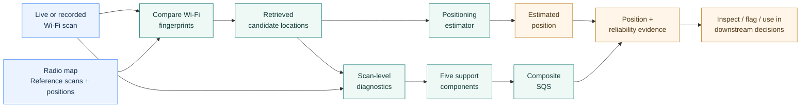

# Wi-Fi Fingerprinting: From Position Estimates to Scan-Level Integrity

**Where am I? How much support does this Wi-Fi scan provide for that answer?**

A reproducible research implementation for **Wi-Fi fingerprinting, scan-level reliability diagnostics, and gross-error analysis**. It extends a conventional positioning workflow with evidence about the *individual scan* behind a location estimate, rather than relying on average accuracy alone.

[](https://github.com/AhmedMansoour/wifi-fingerprinting-scan-level-reliability/actions/workflows/ci.yml)
[](LICENSE)
[](pyproject.toml)

**Start here:** [See how it works](#how-it-works) · [Explore without installing](#1-explore-without-installing) · [Run real measurements](#2-run-the-public-empirical-example) · [Use your own data](#3-use-your-own-fingerprints) · [Understand the results](#what-the-results-mean) · [Documentation](#documentation)

> **In one sentence:** A Wi-Fi fingerprinting system estimates a location; this project also examines **the signal match, nearby reference points, and spatial consistency that support that estimate**.

## The problem in everyday terms

Imagine two phones reporting locations inside a building. Both return a coordinate, but their Wi-Fi scans may tell very different stories:

- **Scan A:** several familiar access points, a plausible match to the reference database, and nearby candidate positions that agree.
- **Scan B:** few familiar access points, weak or ambiguous matching, and candidate positions scattered over a wider area.

A positioning algorithm can return a location for *both* scans. Their reported coordinates alone do not explain why one deserves more scrutiny. The purpose of **scan-level integrity diagnostics** is to expose such supporting evidence so that a positioning system or analyst can recognize questionable estimates and investigate gross errors.

These diagnostics are **decision-support signals**, not a guarantee of correctness. In particular, the composite SQS is **not a calibrated probability** that the position is correct.

## How it works



<details>
<summary><strong>Explain the diagram, one step at a time</strong></summary>

1. **Wi-Fi scan:** a device records which access points it can observe and their received signal strengths (RSS, in dBm).
2. **Radio map:** a collection of reference fingerprints recorded at known local positions. It is a table of signals and positions, **not** a floor-plan image.
3. **Candidate retrieval:** the scan is compared with stored fingerprints to find relevant reference points.
4. **Positioning:** KNN, WKNN, or another estimator produces a location estimate from the available fingerprint evidence.
5. **Reliability diagnostics:** the same scan and nearby candidate set are examined for signal support, compatibility, density, spatial spread, and ambiguity.
6. **Interpretation:** the indicator values and composite scores help diagnose questionable scans. Warning rules require an explicitly stated reference distribution and calibration protocol.

</details>

### What the extra integrity layer examines

| A question a non-expert might ask | Examples of what the code measures |
|---|---|
| **Did the phone hear enough usable Wi-Fi signals?** | Observed AP count and RSS statistics |
| **Does this scan resemble fingerprints we have seen before?** | RSS distance, cosine similarity, AP overlap, AP-set novelty |
| **Are there reference points near the inferred location?** | Nearby reference-point support and local density |
| **Do the best matches point to similar positions?** | Candidate spatial spread, diameter, neighborhood instability |
| **Is the signal pattern ambiguous?** | RSS-gradient uncertainty proxy and composite support measures |

The research uses **18 selected diagnostic quantities**, including **SQS**, **C_sigma**, and **FII**. SQS combines **five equally weighted support components**: signal match, candidate geometry, AP count, AP overlap, and local reference-point density. See the [indicator reference](docs/INDICATORS.md) for precise names and interpretation.

## Choose your starting point

| I want to… | Start with… | What I will get |
|---|---|---|
| **Understand the idea without coding** | [Pipeline above](#how-it-works), [indicator guide](docs/INDICATORS.md), [output examples](examples/empirical_integrity/) | A plain-language explanation and real, precomputed scan-level records |
| **Run it on included real Wi-Fi data** | [Public empirical quick start](#2-run-the-public-empirical-example) | Freshly computed scan diagnostics, SQS, and candidate tables |
| **Try basic positioning estimators** | [HK U09 baseline](#positioning-baseline) | KNN / WKNN / Random Forest error summaries on held-out scans |
| **Use my own radio map** | [Data-format guide](docs/DATASET_DOWNLOADS_AND_FORMAT.md) | A path from source RSS tables to the expected input and model matrices |
| **Audit the study evidence** | [Historical results](#which-results-are-which) | Archived predictions and approved multi-unit summaries, clearly separated from fresh runs |
| **Work with the Android app** | [Android guide](docs/ANDROID.md) | Buildable Java source and a local radio-map import workflow |

### 1. Explore without installing

- Read the [guide to actual measured-data outputs](docs/PUBLIC_EMPIRICAL_INTEGRITY.md).
- Inspect the [public computation summary](examples/empirical_integrity/summary.json) or the [per-scan result files](examples/empirical_integrity/).
- Browse the [synthetic teaching dashboard](dashboard/). To view it locally, clone this repository, run `python -m http.server 8000` from the repository root, and open **http://localhost:8000/dashboard/**. Its illustrated values are **synthetic** and are not the paper's empirical results.

The separate [`web/`](web/) research UI is source code, not a promise of a ready-to-use hosted demo; some views depend on research inputs not shipped here.

### 2. Run the public empirical example

The repository includes **four measured evaluation units**: U01–U03 (three UJIIndoorLoc buildings) and U09 (Hong Kong, with opaque AP labels and local relative coordinates).

Requires Python **3.10+**, a terminal, and an environment with the package dependencies:

```bash
# 1. Clone and enter the repository
git clone https://github.com/AhmedMansoour/wifi-fingerprinting-scan-level-reliability.git
cd wifi-fingerprinting-scan-level-reliability

# 2. Install the reproducible empirical environment
python -m pip install -e ".[dev,empirical]"

# 3. Run the existing scientific reliability implementation
python scripts/reproduce_public_integrity.py

# 4. Check the committed example records and SQS arithmetic
python scripts/check_public_integrity_release.py
```

The computation writes to **`results/public_integrity/`** and leaves the previously approved manuscript outputs untouched. For a shorter single-unit example:

```bash
python scripts/reproduce_public_integrity.py --units U09
```

The current four-unit example processes **20,157 radio-map training scans and 5,041 test scans**, producing **5,041 scan-level records** and **50,410 retrieved-candidate records**. Results are also available without running code in [`examples/empirical_integrity/`](examples/empirical_integrity/).

### 3. Use your own fingerprints

You can provide authorized Wi-Fi observations and positions rather than use the bundled units. The [dataset download and input-format guide](docs/DATASET_DOWNLOADS_AND_FORMAT.md) shows the **eight required columns**, accepted RSS representations, unit IDs, source links, and conversion examples.

```text
dataset,group,split,row_id,floor,x,y,rss_json
```

Here, `split=train` supplies the **radio map**, `split=test` supplies queries, `x`/`y` are **local metric coordinates**, and `rss_json` stores measured RSS values keyed by stable labels such as `AP1` and `AP2`. Missing AP observations are omitted, not assigned fabricated RSS readings.

The repository provides [`scripts/import_external_unit.py`](scripts/import_external_unit.py) to convert supported wide or paired-source CSV tables and [`scripts/stage_existing_units.py`](scripts/stage_existing_units.py) to build processing matrices. For the included UJI study units:

```bash
python scripts/stage_existing_units.py --input-dir data/empirical --units U01 U02 U03
```

To run the native KNN and WKNN estimators after preparing a unit, see [source-data preparation and benchmark commands](docs/DATASET_DOWNLOADS_AND_FORMAT.md). **Your own split or preprocessing may produce different results from the manuscript.**

## What the results mean

The primary output is **one record per query scan**, not simply one aggregate accuracy number.

| Output | How to read it | Location |
|---|---|---|
| Scan-level indicator table | What was observed and how well the scan is supported by the radio map; contains SQS, C_sigma, and FII | `results/public_integrity/Uxx_scan_reliability.csv.gz` |
| Candidate table | Which ten reference fingerprints were retrieved for a scan and their corresponding local positions | `results/public_integrity/Uxx_retrieved_candidates.csv.gz` |
| Run summary | Unit counts, average/median SQS, and input hashes | `results/public_integrity/summary.json` |
| Committed example outputs | Inspectable, **newly computed** native outputs for U01–U03 and U09 | [`examples/empirical_integrity/`](examples/empirical_integrity/) |

**Reading a score:** a low scan-support score may prompt scrutiny of the fingerprint matches and candidate geometry. It is not a direct estimate of metres of positioning error, nor does a high SQS establish that a particular coordinate is correct. Thresholds and warning interpretation depend on the evaluation reference cohort and calibration.

### Which results are which?

| Evidence type | Provided here | What it establishes |
|---|---|---|
| **Fresh empirical calculations** | [`examples/empirical_integrity/`](examples/empirical_integrity/) and the public runner | The source code executes the scan-level reliability computation on the four distributed measured units |
| **Historical HK U09 experiment** | [`results/empirical/hk_u09/`](results/empirical/hk_u09/) | Stored eight-estimator predictions, scan-level indicators, and reliability decisions for **831 queries** |
| **Approved ten-unit summaries** | [`results/approved/`](results/approved/) | Archived aggregate analyses from the research experiment over **10 units and 8 estimators** |
| **Synthetic software demonstration** | [`examples/synthetic_combined/`](examples/synthetic_combined/) and [`dashboard/`](dashboard/) | Deterministic examples for testing and learning; **not measured performance evidence** |

Stored results can be validated without claiming that every historical model was retrained:

```bash
python scripts/verify_existing_research_assets.py
```

### Positioning baseline

A separate, runnable **HK U09** example trains KNN, WKNN, and Random Forest on real public fingerprints and scores **831 held-out scans**:

```bash
python scripts/reproduce_release.py --mode hk-u09
```

This is a **new baseline**, not a recreation of the original eight-estimator manuscript evaluation. See [its configuration and expected outputs](docs/HK_U09_EMPIRICAL_REPRODUCIBILITY.md).

## Dataset availability at a glance

| Units | Status in GitHub | Data access |
|---|---|---|
| **U01–U03** | Measured data included | Three UJIIndoorLoc building units; [attribution and CC BY 4.0 terms](docs/UJI_DATA_ATTRIBUTION.md) |
| **U09** | Measured data included | Anonymous AP identifiers and relative coordinates; original building plans and AP-to-hardware mappings excluded |
| **U04–U08, U10** | Source-linked, not mirrored | [Official original downloads and instructions](docs/DATASET_DOWNLOADS_AND_FORMAT.md) |

The full research evaluation includes **54,520 training scans**, **13,629 query scans**, **10 evaluation units**, and **8 estimators**. The public measured-data runner covers the four units listed above; it is **not** a full fresh ten-unit retraining run. Original publisher datasets can differ from the harmonized study files in preprocessing and split assignments.

## Repository map

| Folder | What lives there |
|---|---|
| [`src/wifi_integrity/`](src/wifi_integrity/) | Python estimators, data handling, scan-level diagnostics, SQS, analyses |
| [`scripts/`](scripts/) | Runnable commands for examples, data preparation, integrity and validation |
| [`data/empirical/`](data/empirical/) · [`data/radio_maps/`](data/radio_maps/) | Distributed measured scans and HK ordered radio-map inputs |
| [`examples/`](examples/) | Synthetic learning data and frozen outputs from fresh public empirical runs |
| [`results/approved/`](results/approved/) | Approved historical aggregate result tables |
| [`config/`](config/) | Dataset units, indicators, and estimator settings |
| [`android/`](android/) | Java/Android Studio application; empty initial database schema |
| [`dashboard/`](dashboard/) · [`web/`](web/) | Synthetic standalone demo and additional research UI source |
| [`docs/`](docs/) · [`tests/`](tests/) | Interpretation, reproducibility guides, and automated tests |

## Android Studio

The Java application supports locally imported Wi-Fi radio maps and on-device scan inspection. It **does not ship with a populated HK database or an original floor-plan asset**. Open [`android/`](android/) in Android Studio with **JDK 17 and Android SDK 35**. Build and test from `android/`:

```bash
./gradlew testDebugUnitTest assembleDebug
```

On Windows use `gradlew.bat`. First-launch radio-map import, profile provenance, and appropriate calibration are described in the [Android guide](docs/ANDROID.md) and [import specification](android/IMPORT_FORMAT.md). The historical post-retrieval timing measurement does **not** represent total Wi-Fi acquisition-to-position latency.

## Documentation

| Topic | Guide |
|---|---|
| First encounter with scan-level reliability | [Research overview](docs/RESEARCH_OVERVIEW.md) · [Indicator glossary and directions](docs/INDICATORS.md) |
| Run and interpret public measurements | [Empirical example](docs/PUBLIC_EMPIRICAL_INTEGRITY.md) · [Reproducibility boundaries](docs/REPRODUCIBILITY.md) |
| Obtain or format datasets | [Source download and eight-column format](docs/DATASET_DOWNLOADS_AND_FORMAT.md) · [UJI attribution](docs/UJI_DATA_ATTRIBUTION.md) |
| Recreate estimator baselines | [Native estimators](docs/ESTIMATORS.md) · [HK example](docs/HK_U09_EMPIRICAL_REPRODUCIBILITY.md) |
| Understand warning calibration | [Calibration](docs/CALIBRATION.md) · [Warning calibration](docs/WARNING_CALIBRATION.md) |
| Build the mobile application | [Android](docs/ANDROID.md) · [Runtime measurement scope](docs/ANDROID_TIMING.md) |
| Check research assets and data privacy | [Historical asset verification](docs/EXISTING_RESEARCH_ASSETS.md) · [Data and privacy](docs/DATA_AND_PRIVACY.md) |

<details>
<summary><strong>Frequently asked questions</strong></summary>

**Is SQS an accuracy prediction or an error probability?** No. It is a composite measure of scan and radio-map support using cohort-relative scaling. An independent calibration is needed before interpreting cutoffs as deployment decision rules.

**Do I need a real floor-plan image?** No. The fingerprint radio map consists of RSS observations and their associated local positions. No original HK floor-plan image or vector data is included.

**Do I need all ten empirical datasets to try the method?** No. Four measured units are committed for a runnable integrity example. Six additional source datasets have official download links for local preparation.

**Are archived results the same as a fresh rerun?** No. The archived tables document the original research; the public runner generates a new calculation with the available inputs. Slight numerical differences can arise from floating-point candidate retrieval, and the checker documents the tolerance for the fresh U09 aggregate SQS comparison.

**Can I use this for real-time safety-critical decisions?** The published research diagnostics do not by themselves establish calibrated future error probabilities or an independently verified prospective alarm system.

</details>

## License, research context, and citation

- **Code and synthetic fixtures:** [MIT License](LICENSE).
- **UJIIndoorLoc U01–U03:** original [CC BY 4.0 terms and attribution](docs/UJI_DATA_ATTRIBUTION.md). Empirical measurements are **not automatically relicensed by the code's MIT license**.
- **Other external datasets:** obtain them from their source publishers and follow their separate terms. See [data handling](docs/DATA_AND_PRIVACY.md) and [third-party notices](THIRD_PARTY_NOTICES.md).

This software accompanies ongoing research in **Expert Systems with Applications** on scan-level reliability, gross-error diagnosis, and integrity-aware Wi-Fi fingerprinting. The manuscript is **not** distributed in this repository. For academic use, cite the underlying datasets and the associated article when its publication details are available; do not invent a DOI or published status.
