# Scan-Level Reliability and Gross-Error Diagnosis in Wi-Fi Fingerprinting

**Reproducible methods, measured data, and software for evaluating the reliability evidence associated with individual Wi-Fi fingerprints.**

### Animated interface concept: four illustrative cases

<p align="center">
  <a href="https://ahmedmansoour.github.io/wifi-fingerprinting-scan-level-reliability/learn/interactive-explorer/">
    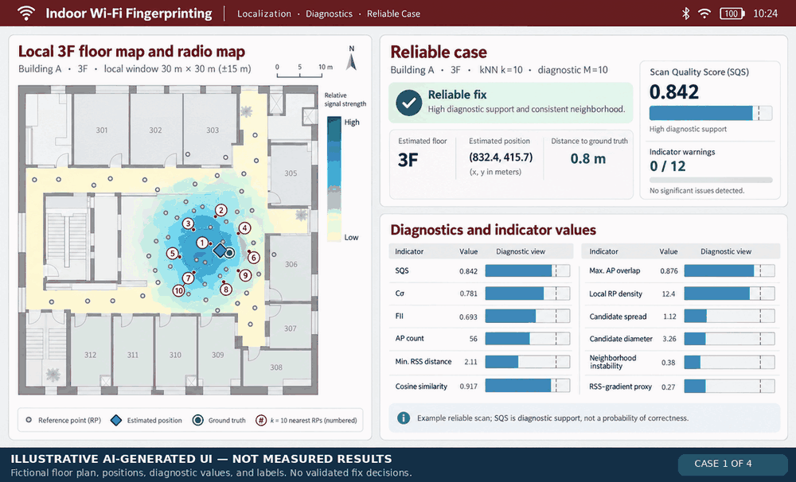
  </a>
</p>

> **Illustrative concept only, not research evidence.** These four frames are AI-generated UI mock-ups. The depicted third-floor plan, radio map, reference points, estimated and ground-truth locations, distance errors, indicator readings, and reliable/unreliable classifications are **fictional**, not measured research outputs or independently calibrated warning decisions. For actual study-derived observations, open the [measured-scan explorer](https://ahmedmansoour.github.io/wifi-fingerprinting-scan-level-reliability/learn/interactive-explorer/) and [scientific evidence matrix](https://ahmedmansoour.github.io/wifi-fingerprinting-scan-level-reliability/results/evidence-matrix/).


This research software evaluates RSS observations, radio-map compatibility, spatial consistency, and ambiguity alongside Wi-Fi fingerprinting position estimates. It implements **15 individual diagnostic quantities and three composite scores** (SQS, Cσ, and FII), with reproducible Python/Android source, measured public examples, and archived evaluation results.

[](https://github.com/AhmedMansoour/wifi-fingerprinting-scan-level-reliability/actions/workflows/ci.yml)
[](LICENSE)
[](pyproject.toml)

**Explore new scientific visualizations:** [Interactive SQS and ablation study](https://ahmedmansoour.github.io/wifi-fingerprinting-scan-level-reliability/learn/sqs-ablation/) · [Side-by-side measured scan comparison](https://ahmedmansoour.github.io/wifi-fingerprinting-scan-level-reliability/learn/compare-scans/) · [Estimator and diagnostic evidence matrix](https://ahmedmansoour.github.io/wifi-fingerprinting-scan-level-reliability/results/evidence-matrix/)

**Start here:** [Mathematical inventory and README illustrations](#diagnostic-framework-15-quantities-and-three-composites) · [Animated indicator atlas](https://ahmedmansoour.github.io/wifi-fingerprinting-scan-level-reliability/learn/indicator-atlas/) · [Measured-scan explorer](https://ahmedmansoour.github.io/wifi-fingerprinting-scan-level-reliability/learn/interactive-explorer/) · [Documentation homepage](https://ahmedmansoour.github.io/wifi-fingerprinting-scan-level-reliability/) · [Methodological architecture](#methodological-architecture) · [Explore without installing](#1-explore-without-installing) · [Run real measurements](#2-run-the-public-empirical-example) · [Use your own data](#3-use-your-own-fingerprints) · [Understand the results](#what-the-results-mean) · [Documentation](#documentation)

> **Research scope:** Scan-level diagnostic quantities characterize RSS observation structure, fingerprint compatibility, retrieved-candidate geometry and radio-map support alongside independently generated positioning estimates.

### Android scan-level inspection interface

The Android implementation displays the latest scan-level inspection result, including the inferred floor, the scan-level diagnostic state, AP coverage, and SQS. The diagnostic views report the raw indicator values alongside their adverse-percentile positions and threshold exceedances, organized by composite indicators, RSS statistics, scan–radio-map compatibility, spatial support, candidate geometry, and radio-map ambiguity.

<p align="center">
  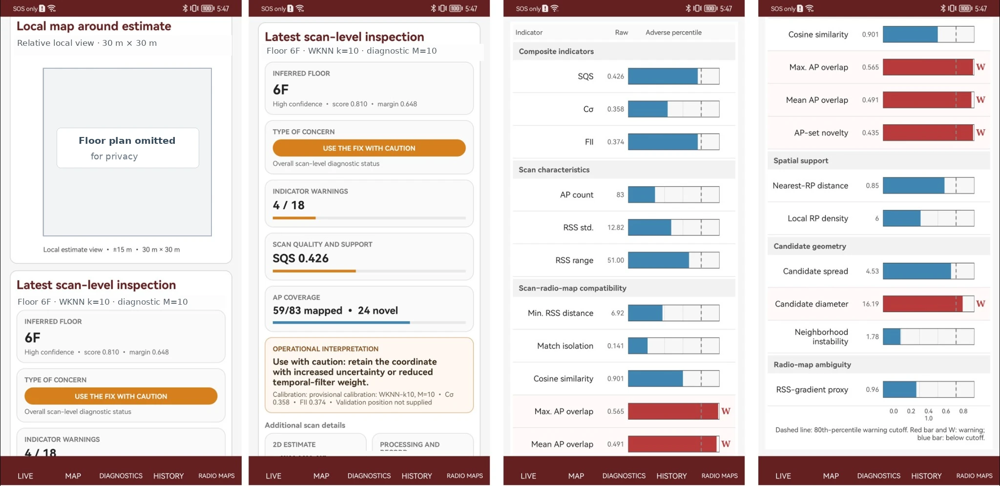
</p>

*Android interface excerpts from the manuscript implementation.* From left: full-height local-map screen with the confidential floor-plan content masked; scan inspection and SQS; composite and RSS/fingerprint compatibility indicators; and AP-overlap, spatial-support, candidate-geometry and radio-map-ambiguity diagnostics. Identifying site references and coordinates are masked; the screen itself is not cropped. The displayed warning is an example of the application's **provisional diagnostic interpretation**, not an independently validated prospective error guarantee.

## Visual research explorer

Five animated previews of the public research tools. Bars reveal recorded values; the underlying measurements do not change. **Select a figure to open its interactive version** on GitHub Pages. The diagrams below display source-derived values, not simulated positioning performance.

### Compare individual Wi-Fi scans

<a href="https://ahmedmansoour.github.io/wifi-fingerprinting-scan-level-reliability/learn/compare-scans/">
  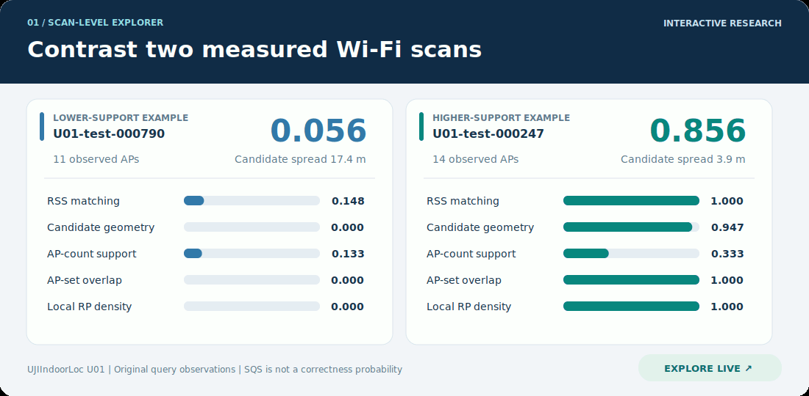
</a>

*Measured U01 queries with contrasting diagnostic support. Individual SQS values are not calibrated probabilities of positioning correctness.* [Open the interactive scan comparison](https://ahmedmansoour.github.io/wifi-fingerprinting-scan-level-reliability/learn/compare-scans/).

### Explore SQS components and ablations

<a href="https://ahmedmansoour.github.io/wifi-fingerprinting-scan-level-reliability/learn/sqs-ablation/">
  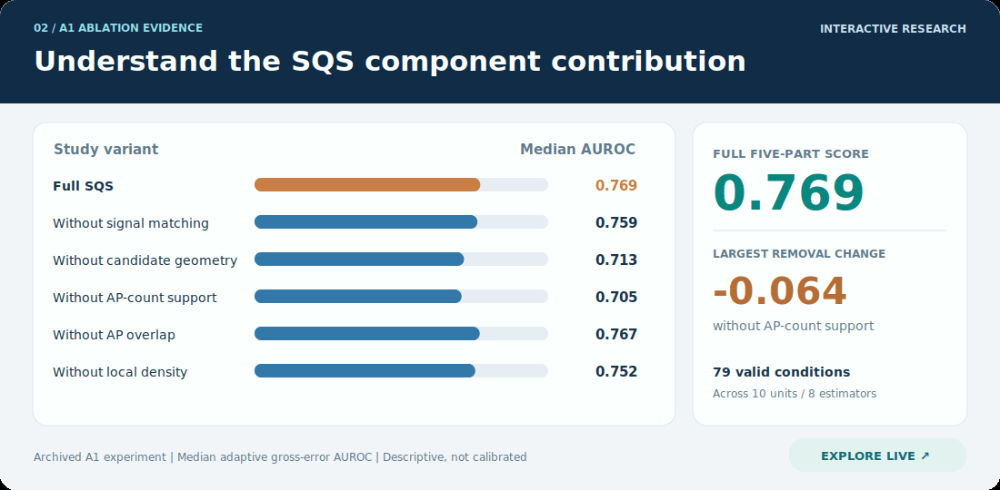
</a>

*Archived A1 results across 79 valid adaptive gross-error conditions. Values are retrospective medians, not new scan-level predictions.* [Open the interactive SQS explorer](https://ahmedmansoour.github.io/wifi-fingerprinting-scan-level-reliability/learn/sqs-ablation/).

### Compare the scientific evidence

<a href="https://ahmedmansoour.github.io/wifi-fingerprinting-scan-level-reliability/results/evidence-matrix/">
  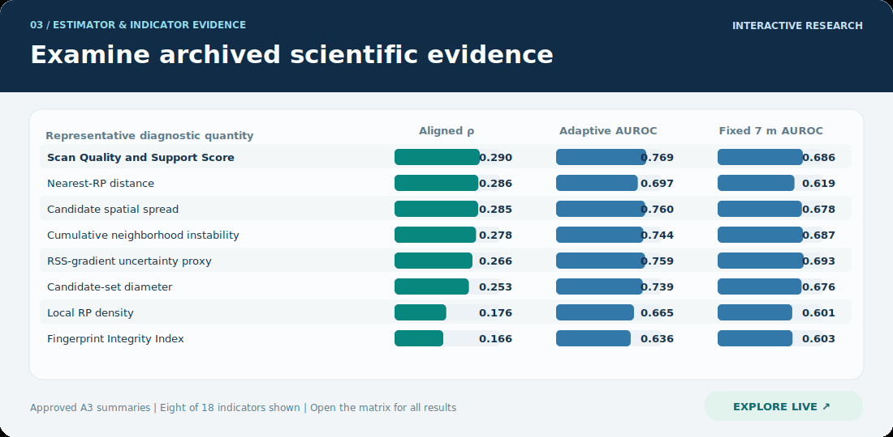
</a>

*Eight of 18 archived A3 indicator summaries. The full page includes additional statistics, uncertainty intervals, and estimator-level aggregate results.* [Open the full evidence matrix](https://ahmedmansoour.github.io/wifi-fingerprinting-scan-level-reliability/results/evidence-matrix/).


### Additional measured scan cases

<a href="https://ahmedmansoour.github.io/wifi-fingerprinting-scan-level-reliability/learn/interactive-explorer/">
  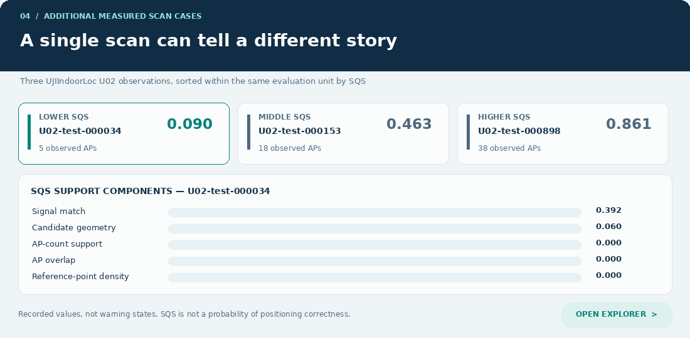
</a>

*Three held-out UJIIndoorLoc U02 queries, cycling from lower to middle to higher SQS within the same unit. All values were exported from the original source; none are calibrated warning states.* [Explore measured scans](https://ahmedmansoour.github.io/wifi-fingerprinting-scan-level-reliability/learn/interactive-explorer/).

### Relative x–y candidate geometry

<a href="https://ahmedmansoour.github.io/wifi-fingerprinting-scan-level-reliability/learn/interactive-explorer/">
  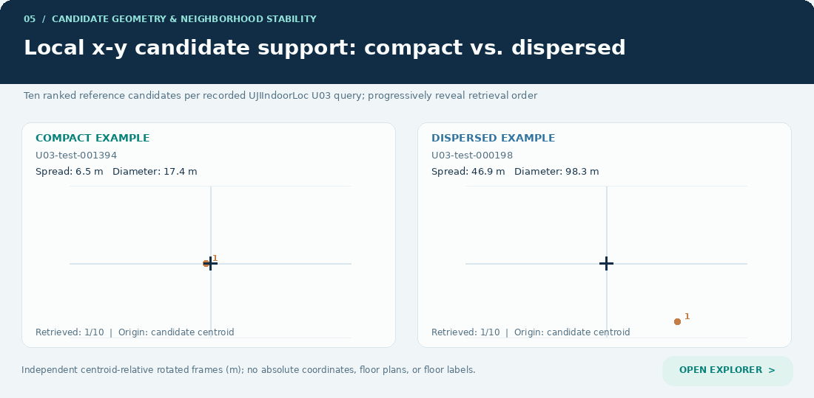
</a>

*Two measured UJIIndoorLoc U03 neighborhoods. The animation reveals the ten ranked retrieval candidates and their centroid-relative spatial dispersion. Each frame is independently rotated and centered to prevent a common building-coordinate reference; no floor plan, floor label, original x–y location, or absolute spatial origin is shown.* [Explore candidate geometry](https://ahmedmansoour.github.io/wifi-fingerprinting-scan-level-reliability/learn/interactive-explorer/).

## Motivation: from aggregate error to scan-level diagnostics

Average positioning accuracy and error percentiles summarize a model across many scans, but they do not describe the evidence supporting a particular prediction. Two queries can yield apparently plausible coordinates while differing substantially in **observed AP coverage, signal-space matching, candidate spatial consistency, and local radio-map support**.

The reliability layer computes these indicators directly from the query and its reference neighborhood. They can support retrospective error analysis and development of calibrated gross-error detection rules, without treating a nominally close fingerprint match as proof of low positioning error.

**SQS is a cohort-normalized diagnostic support score**, not the probability that a predicted location is correct. Operational accept/reject rules require independent calibration and held-out evaluation.

## Methodological architecture

The implementation separates **position estimation** from **post-retrieval reliability assessment**. The positioning estimator produces an estimated coordinate; the diagnostic layer characterizes the evidence supporting that coordinate using the query, the retrieved fingerprint neighborhood and radio-map geometry. Only the estimator-specific nearest-RP distance requires the predicted coordinate.

**Figure 1. Fingerprint retrieval, estimation and diagnostic inference**

<p align="center">
  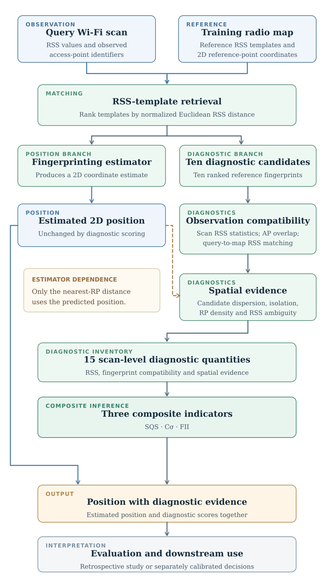
</p>

The first ten retrieved templates define the candidate neighborhood used for spatial and AP-overlap diagnostics. The source retrieval may probe up to 20 nearest templates before forming the diagnostic candidate set. Repeated training observations at a common coordinate and floor are aggregated into a template. The drawings below are **methodological schematics, not HK floor plans, radio maps, or observed spatial point clouds**.

## Diagnostic framework: 15 quantities and three composites

Each query scan is represented by its observed APs and their RSS measurements in dBm. For comparison with the radio map, the query and reference-template RSS vectors are aligned to a common AP feature space, with missing AP measurements assigned −110 dBm. Reference templates are ranked by normalized Euclidean RSS distance to the query, and the ten nearest templates define the candidate neighborhood used for AP-overlap and spatial diagnostics. Each candidate has a two-dimensional reference coordinate; the average of the ten candidate coordinates defines the neighborhood centroid. Spatial-support diagnostics additionally consider all distinct training reference coordinates. AP-set agreement is quantified by Jaccard overlap, the proportion of APs shared by the query and a reference template relative to the total number observed in either.

### 1. Query RSS statistics

**Figure 2. Scan-level observation descriptors**

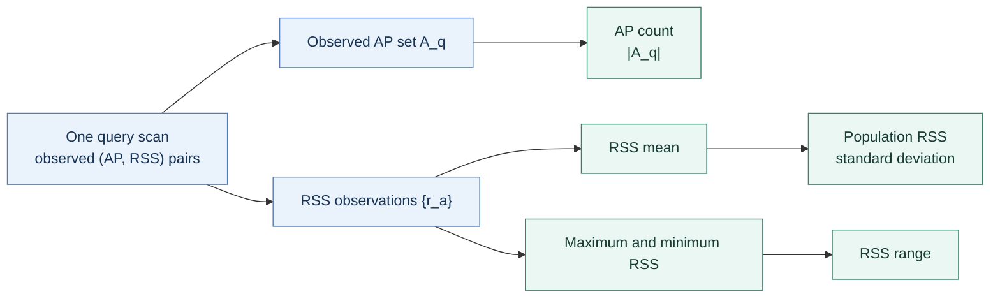

These quantities describe observed AP visibility and RSS dispersion, **not a direct estimate of positioning accuracy**. In particular, the prespecified adverse directions of RSS standard deviation and range were not consistent across evaluated conditions.

### 2. Query–radio-map compatibility

**Figure 3. RSS matching and AP-set agreement**

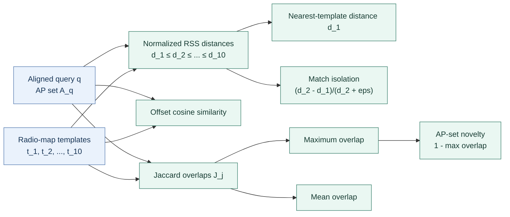

The diagram distinguishes **signal-space distance**, **nearest-template separation**, **vector alignment** and **AP-set agreement**. These are different properties of a fingerprint match, not interchangeable measures of confidence.

### 3. Spatial support and candidate geometry

**Figure 4. Candidate-neighborhood descriptors**

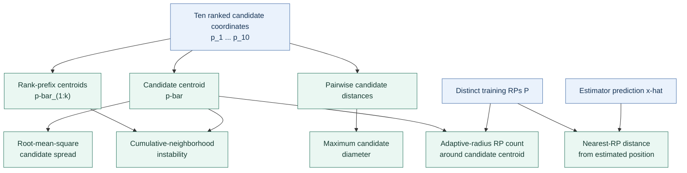

The candidate centroid, spread, diameter and instability describe the geometry of the retrieved neighborhood. Local RP density counts distinct training coordinates within the specified adaptive radius, **not just the ten candidates**. Nearest-RP distance is **estimator dependent**; it is not computed from the scan alone.

### 4. Radio-map ambiguity

**Figure 5. Spatial dispersion relative to signal-distance contrast**

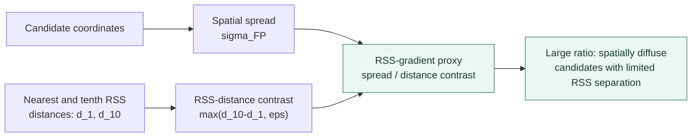

This is an **ambiguity proxy**, not a physical RSS gradient estimated from a floor-plan surface.

### 5. Composite support scores

**Figure 6. Exact component structure of SQS, Cσ and FII**

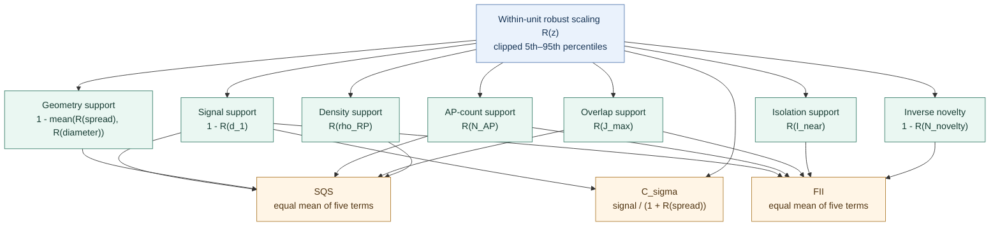

$R(z)=\mathrm{clip}[(z-Q_{0.05})/(Q_{0.95}-Q_{0.05}),0,1]$ uses the **complete evaluation unit**, not only the selected visual examples. For a degenerate finite range, the implementation returns $0.5$; unavailable values remain missing and are omitted from composite means. Higher composite values denote stronger relative support under their construction; they are **not calibrated probabilities of a correct position**.

### Mathematical inventory

All **18** implemented quantities are presented here; exact handling of missing values, calibration conditions and source-code mappings are in [the mathematical reference](docs/INDICATORS.md).

| Family | Implemented quantity | Definition or operation | Prespecified adverse direction |
|---|---|---|---|
| RSS statistics | **AP count** | $N_{AP}=|A_q|$ | Low |
| RSS statistics | **RSS standard deviation** | $\sigma_{RSS}=\sqrt{\frac1N\sum_{a\in A_q}(r_a-\bar r)^2}$ | High* |
| RSS statistics | **RSS range** | $\max_a r_a-\min_a r_a$ | High* |
| Scan–map compatibility | **Minimum RSS distance** | $d_1=\min_j\|\mathbf q-\mathbf t_j\|_2/\sqrt D$ | High |
| Scan–map compatibility | **Nearest-match isolation** | $I_{\mathrm{near}}=\max(d_2-d_1,0)/(d_2+10^{-6})$ | Low |
| Scan–map compatibility | **Cosine similarity** | $\cos(\mathbf q+110,\mathbf t_1+110)$ | Low |
| Scan–map compatibility | **Maximum AP overlap** | $J_{\max}=\max_{j\leq10}J(A_q,A_j)$ | Low |
| Scan–map compatibility | **Mean AP overlap** | $\bar J=\frac1{10}\sum_{j=1}^{10}J(A_q,A_j)$ | Low |
| Scan–map compatibility | **AP-set novelty** | $N_{\mathrm{novel}}=1-J_{\max}$ | High |
| Spatial support | **Nearest-RP distance** | $d_{RP}=\min_{\mathbf p\in\mathcal P}\|\hat{\mathbf x}-\mathbf p\|_2$ | High |
| Spatial support | **Local RP density** | $\rho_{RP}=\sum_{\mathbf p\in\mathcal P}\mathbf1\{\|\mathbf p-\bar{\mathbf p}\|_2\leq r\}$ | Low |
| Candidate geometry | **Candidate spatial spread** | $\sigma_{FP}=\sqrt{\frac1{10}\sum_j\|\mathbf p_j-\bar{\mathbf p}\|_2^2}$ | High |
| Candidate geometry | **Candidate-set diameter** | $D_{cand}=\max_{i,j}\|\mathbf p_i-\mathbf p_j\|_2$ | High |
| Candidate geometry | **Cumulative-neighborhood instability** | $I_k=\max_{1\leq k\leq10}\|\bar{\mathbf p}_{1:k}-\bar{\mathbf p}\|_2$ | High |
| Radio-map ambiguity | **RSS-gradient proxy** | $G_{RSS}=\sigma_{FP}/\max(d_{10}-d_1,10^{-6})$ | High |
| Composite support | **SQS** | $\mathrm{mean}\!\left(1-R(d_1),1-\frac{R(\sigma_{FP})+R(D_{cand})}{2},R(N_{AP}),R(J_{\max}),R(\rho_{RP})\right)$ | Low |
| Composite support | **Cσ** | $(1-R(d_1))/(1+R(\sigma_{FP}))$ | Low |
| Composite support | **FII** | $\mathrm{mean}\!\left(1-R(d_1),R(N_{AP}),R(J_{\max}),R(I_{\mathrm{near}}),1-R(N_{\mathrm{novel}})\right)$ | Low |

*The adverse directions are prespecified analytical hypotheses, not universal empirical findings. In particular, higher RSS standard deviation or range did not consistently imply worse positioning accuracy.*

### Interactive scientific illustrations

The preceding six figures render **inside this GitHub README** using Mermaid. For source-derived animated diagrams, scanned RSS observations, candidate interactions and all 18 indicator views, use the live documentation:

- **[Interactive indicator atlas: 18 equations, animated representations and measured values](https://ahmedmansoour.github.io/wifi-fingerprinting-scan-level-reliability/learn/indicator-atlas/)**
- **[Measured-scan explorer: 88 selected query scans and native SQS breakdowns](https://ahmedmansoour.github.io/wifi-fingerprinting-scan-level-reliability/learn/interactive-explorer/)**

GitHub Markdown renders diagrams but does not execute embedded JavaScript dashboards or iframes. The interactive tools therefore remain hosted on GitHub Pages; the README figures and complete indicator inventory remain readable without leaving the repository.

## Choose your starting point

| Research workflow | Entry point | Available evidence |
|---|---|---|
| **Inspect diagnostic construction** | [README figures](#methodological-architecture), [implemented indicator equations](docs/INDICATORS.md), [measured outputs](examples/empirical_integrity/) | Source-mapped definitions and archived per-scan diagnostic records |
| **Run it on included real Wi-Fi data** | [Public empirical quick start](#2-run-the-public-empirical-example) | Freshly computed scan diagnostics, SQS, and candidate tables |
| **Try basic positioning estimators** | [HK U09 baseline](#positioning-baseline) | KNN / WKNN / Random Forest error summaries on held-out scans |
| **Use my own radio map** | [Data-format guide](docs/DATASET_DOWNLOADS_AND_FORMAT.md) | A path from source RSS tables to the expected input and model matrices |
| **Audit the study evidence** | [Historical results](#which-results-are-which) | Archived predictions and approved multi-unit summaries, clearly separated from fresh runs |
| **Work with the Android app** | [Android guide](docs/ANDROID.md) | Buildable Java source and a local radio-map import workflow |

### 1. Explore without installing

- Read the [guide to actual measured-data outputs](docs/PUBLIC_EMPIRICAL_INTEGRITY.md).
- Inspect the [public computation summary](examples/empirical_integrity/summary.json) or the [per-scan result files](examples/empirical_integrity/).
- Browse the [synthetic teaching dashboard](dashboard/). To view it locally, clone this repository, run `python -m http.server 8000` from the repository root, and open **http://localhost:8000/dashboard/**. Its illustrated values are **synthetic** and are not the paper's empirical results.

The separate [`web/`](web/) research UI is source code, not a promise of a ready-to-use hosted demo; some views depend on research inputs not shipped here.

### 2. Run the public empirical example

The repository includes **four measured evaluation units**: U01–U03 (three UJIIndoorLoc buildings) and U09 (Hong Kong, with opaque AP labels and local relative coordinates).

Requires Python **3.10+**, a terminal, and an environment with the package dependencies:

```bash
# 1. Clone and enter the repository
git clone https://github.com/AhmedMansoour/wifi-fingerprinting-scan-level-reliability.git
cd wifi-fingerprinting-scan-level-reliability

# 2. Install the reproducible empirical environment
python -m pip install -e ".[dev,empirical]"

# 3. Run the existing scientific reliability implementation
python scripts/reproduce_public_integrity.py

# 4. Check the committed example records and SQS arithmetic
python scripts/check_public_integrity_release.py
```

The computation writes to **`results/public_integrity/`** and leaves the previously approved manuscript outputs untouched. For a shorter single-unit example:

```bash
python scripts/reproduce_public_integrity.py --units U09
```

The current four-unit example processes **20,157 radio-map training scans and 5,041 test scans**, producing **5,041 scan-level records** and **50,410 retrieved-candidate records**. Results are also available without running code in [`examples/empirical_integrity/`](examples/empirical_integrity/).

### 3. Use your own fingerprints

You can provide authorized Wi-Fi observations and positions rather than use the bundled units. The [dataset download and input-format guide](docs/DATASET_DOWNLOADS_AND_FORMAT.md) shows the **eight required columns**, accepted RSS representations, unit IDs, source links, and conversion examples.

```text
dataset,group,split,row_id,floor,x,y,rss_json
```

Here, `split=train` supplies the **radio map**, `split=test` supplies queries, `x`/`y` are **local metric coordinates**, and `rss_json` stores measured RSS values keyed by stable labels such as `AP1` and `AP2`. Missing AP observations are omitted, not assigned fabricated RSS readings.

The repository provides [`scripts/import_external_unit.py`](scripts/import_external_unit.py) to convert supported wide or paired-source CSV tables and [`scripts/stage_existing_units.py`](scripts/stage_existing_units.py) to build processing matrices. For the included UJI study units:

```bash
python scripts/stage_existing_units.py --input-dir data/empirical --units U01 U02 U03
```

To run the native KNN and WKNN estimators after preparing a unit, see [source-data preparation and benchmark commands](docs/DATASET_DOWNLOADS_AND_FORMAT.md). **Your own split or preprocessing may produce different results from the manuscript.**

## What the results mean

The primary output is **one record per query scan**, not simply one aggregate accuracy number.

| Output | How to read it | Location |
|---|---|---|
| Scan-level indicator table | What was observed and how well the scan is supported by the radio map; contains SQS, C_sigma, and FII | `results/public_integrity/Uxx_scan_reliability.csv.gz` |
| Candidate table | Which ten reference fingerprints were retrieved for a scan and their corresponding local positions | `results/public_integrity/Uxx_retrieved_candidates.csv.gz` |
| Run summary | Unit counts, average/median SQS, and input hashes | `results/public_integrity/summary.json` |
| Committed example outputs | Inspectable, **newly computed** native outputs for U01–U03 and U09 | [`examples/empirical_integrity/`](examples/empirical_integrity/) |

**Reading a score:** a low scan-support score may prompt scrutiny of the fingerprint matches and candidate geometry. It is not a direct estimate of metres of positioning error, nor does a high SQS establish that a particular coordinate is correct. Thresholds and warning interpretation depend on the evaluation reference cohort and calibration.

### Which results are which?

| Evidence type | Provided here | What it establishes |
|---|---|---|
| **Fresh empirical calculations** | [`examples/empirical_integrity/`](examples/empirical_integrity/) and the public runner | The source code executes the scan-level reliability computation on the four distributed measured units |
| **Historical HK U09 experiment** | [`results/empirical/hk_u09/`](results/empirical/hk_u09/) | Stored eight-estimator predictions, scan-level indicators, and reliability decisions for **831 queries** |
| **Approved ten-unit summaries** | [`results/approved/`](results/approved/) | Archived aggregate analyses from the research experiment over **10 units and 8 estimators** |
| **Synthetic software demonstration** | [`examples/synthetic_combined/`](examples/synthetic_combined/) and [`dashboard/`](dashboard/) | Deterministic examples for testing and learning; **not measured performance evidence** |

Stored results can be validated without claiming that every historical model was retrained:

```bash
python scripts/verify_existing_research_assets.py
```

### Positioning baseline

A separate, runnable **HK U09** example trains KNN, WKNN, and Random Forest on real public fingerprints and scores **831 held-out scans**:

```bash
python scripts/reproduce_release.py --mode hk-u09
```

This is a **new baseline**, not a recreation of the original eight-estimator manuscript evaluation. See [its configuration and expected outputs](docs/HK_U09_EMPIRICAL_REPRODUCIBILITY.md).

## Dataset availability at a glance

| Units | Status in GitHub | Data access |
|---|---|---|
| **U01–U03** | Measured data included | Three UJIIndoorLoc building units; [attribution and CC BY 4.0 terms](docs/UJI_DATA_ATTRIBUTION.md) |
| **U09** | Measured data included | Anonymous AP identifiers and relative coordinates; original building plans and AP-to-hardware mappings excluded |
| **U04–U08, U10** | Source-linked, not mirrored | [Official original downloads and instructions](docs/DATASET_DOWNLOADS_AND_FORMAT.md) |

The full research evaluation includes **54,520 training scans**, **13,629 query scans**, **10 evaluation units**, and **8 estimators**. The public measured-data runner covers the four units listed above; it is **not** a full fresh ten-unit retraining run. Original publisher datasets can differ from the harmonized study files in preprocessing and split assignments.

## Repository map

| Folder | What lives there |
|---|---|
| [`src/wifi_integrity/`](src/wifi_integrity/) | Python estimators, data handling, scan-level diagnostics, SQS, analyses |
| [`scripts/`](scripts/) | Runnable commands for examples, data preparation, integrity and validation |
| [`data/empirical/`](data/empirical/) · [`data/radio_maps/`](data/radio_maps/) | Distributed measured scans and HK ordered radio-map inputs |
| [`examples/`](examples/) | Synthetic learning data and frozen outputs from fresh public empirical runs |
| [`results/approved/`](results/approved/) | Approved historical aggregate result tables |
| [`config/`](config/) | Dataset units, indicators, and estimator settings |
| [`android/`](android/) | Java/Android Studio application; empty initial database schema |
| [`dashboard/`](dashboard/) · [`web/`](web/) | Synthetic standalone demo and additional research UI source |
| [`docs/`](docs/) · [`tests/`](tests/) | Interpretation, reproducibility guides, and automated tests |

## Android Studio

The Java application supports locally imported Wi-Fi radio maps and on-device scan inspection. It **does not ship with a populated HK database or an original floor-plan asset**. Open [`android/`](android/) in Android Studio with **JDK 17 and Android SDK 35**. Build and test from `android/`:

```bash
./gradlew testDebugUnitTest assembleDebug
```

On Windows use `gradlew.bat`. First-launch radio-map import, profile provenance, and appropriate calibration are described in the [Android guide](docs/ANDROID.md) and [import specification](android/IMPORT_FORMAT.md). The historical post-retrieval timing measurement does **not** represent total Wi-Fi acquisition-to-position latency.


## Documentation

| Topic | Guide |
|---|---|
| First encounter with scan-level reliability | [Research overview](docs/RESEARCH_OVERVIEW.md) · [Indicator glossary and directions](docs/INDICATORS.md) |
| Run and interpret public measurements | [Empirical example](docs/PUBLIC_EMPIRICAL_INTEGRITY.md) · [Reproducibility boundaries](docs/REPRODUCIBILITY.md) |
| Obtain or format datasets | [Source download and eight-column format](docs/DATASET_DOWNLOADS_AND_FORMAT.md) · [UJI attribution](docs/UJI_DATA_ATTRIBUTION.md) |
| Recreate estimator baselines | [Native estimators](docs/ESTIMATORS.md) · [HK example](docs/HK_U09_EMPIRICAL_REPRODUCIBILITY.md) |
| Understand warning calibration | [Calibration](docs/CALIBRATION.md) · [Warning calibration](docs/WARNING_CALIBRATION.md) |
| Build the mobile application | [Android](docs/ANDROID.md) · [Runtime measurement scope](docs/ANDROID_TIMING.md) |
| Check research assets and data privacy | [Historical asset verification](docs/EXISTING_RESEARCH_ASSETS.md) · [Data and privacy](docs/DATA_AND_PRIVACY.md) |

<details>
<summary><strong>Frequently asked questions</strong></summary>

**Is SQS an accuracy prediction or an error probability?** No. It is a composite measure of scan and radio-map support using cohort-relative scaling. An independent calibration is needed before interpreting cutoffs as deployment decision rules.

**Do I need a real floor-plan image?** No. The fingerprint radio map consists of RSS observations and their associated local positions. No original HK floor-plan image or vector data is included.

**Do I need all ten empirical datasets to try the method?** No. Four measured units are committed for a runnable integrity example. Six additional source datasets have official download links for local preparation.

**Are archived results the same as a fresh rerun?** No. The archived tables document the original research; the public runner generates a new calculation with the available inputs. Slight numerical differences can arise from floating-point candidate retrieval, and the checker documents the tolerance for the fresh U09 aggregate SQS comparison.

**Can I use this for real-time safety-critical decisions?** The published research diagnostics do not by themselves establish calibrated future error probabilities or an independently verified prospective alarm system.

</details>

## License, research context, and citation

- **Code and synthetic fixtures:** [MIT License](LICENSE).
- **UJIIndoorLoc U01–U03:** original [CC BY 4.0 terms and attribution](docs/UJI_DATA_ATTRIBUTION.md). Empirical measurements are **not automatically relicensed by the code's MIT license**.
- **Other external datasets:** obtain them from their source publishers and follow their separate terms. See [data handling](docs/DATA_AND_PRIVACY.md) and [third-party notices](THIRD_PARTY_NOTICES.md).

### Cite the companion ESWA manuscript

**Mansour, A., Chen, W., Luo, H., Adham, M., Wang, J., Abdallah, M., and Weng, D. (2026).** “An Intelligent Framework for Scan-Level Reliability, Accuracy Diagnostics, and Gross-Error Detection in Wi-Fi Fingerprinting-Based Indoor Positioning Systems.” *Expert Systems with Applications* (manuscript under revision, **ESWA-D-26-23796R2**).

The citation uses the manuscript's full author order and exact current title. **This work is not yet published**: no DOI, volume, article number, or acceptance date is claimed. The manuscript PDF is not distributed through this repository.

**BibTeX:** [Download the companion manuscript citation](CITATION.bib). **Repository citation:** GitHub's `Cite this repository` control uses [`CITATION.cff`](CITATION.cff). Please also cite the original datasets under their respective licenses.
