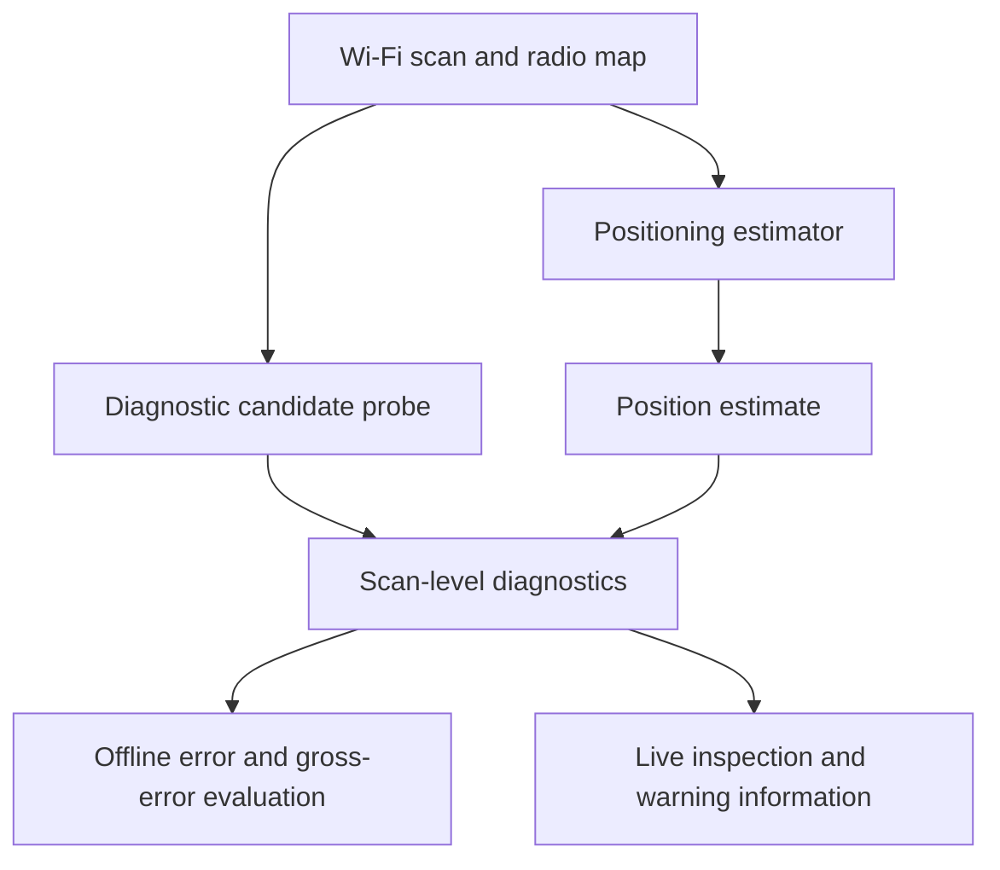

# Research overview

[Home](../README.md) · [Indicators](INDICATORS.md) · [Reproducibility](REPRODUCIBILITY.md)

## From a position estimate to diagnostic information

The research asks which observable properties of a Wi-Fi scan and its relationship to a radio map help identify unreliable individual position fixes. Positioning error is used as the evaluation target in the offline study; it is not assumed to be available during live operation.

The diagnostic candidate probe retrieves RSS-similar reference fingerprints. Their compatibility and spatial arrangement complement information from the scan itself and the location of the estimated position. Using a common probe supports comparison across positioning estimators with different error-generation mechanisms.

The diagram summarizes the relationship between components; the offline evaluation and the Android application use distinct execution and calibration contexts.

## Evaluation design

The study evaluates 18 indicators across 10 building-level units and eight positioning estimators. The design includes retrieval methods, tree ensembles, boosted trees, and deep regressors. Estimator diversity tests how diagnostic behavior changes with the method used to produce the position estimate.

The evaluation connects continuous error association with gross-error discrimination, confidently wrong cases, cross-condition consistency, floor-aware analysis, and parameter sensitivity. These complementary analyses address different questions and are not interchangeable validation claims.

| Question | Evidence considered |
| --- | --- |
| Does an indicator track error magnitude? | Direction-aligned rank association |
| Does it identify severe failures? | Adaptive and fixed-threshold gross-error discrimination |
| Can apparently favorable matching conceal a bad fix? | Confidently wrong analysis and diagnostic cases |
| Does the interpretation persist across conditions? | Cross-unit, cross-estimator, floor-aware, and parameter-sensitivity analyses |

## Interpretation boundaries

- Reliability scores and adverse percentiles are not calibrated correctness probabilities or guaranteed integrity bounds.
- SQS is a predefined composite, with five equally weighted support components, rather than an optimized or trained predictor.
- The final indicator ranking follows the manuscript's robustness index. Other analyses provide complementary checks.
- The offline auxiliary floor voter does not measure vertical error generated by the eight horizontal estimators.
- The study does not establish the effect of these diagnostics on a complete downstream multisensor fusion system.
- A runtime claim must identify the device, radio-map size, AP dimension, and timed stage. Indicator computation, candidate retrieval, and Android scan acquisition are separate stages.

The supplied implementations are being reconciled with the current manuscript before a complete executable research release is claimed.
