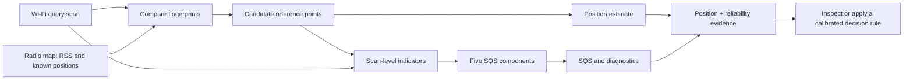

<div class="wf-hero" markdown="1">
<div class="wf-kicker">EXPLAIN · IMPLEMENT · VERIFY</div>

# From a Wi-Fi location to the evidence behind it

A Wi-Fi fingerprinting system gives you a position. **This research adds scan-level evidence for judging how well the Wi-Fi observations and radio-map matches support that position.**

[Get started with real data](start/quickstart.md){ .md-button .md-button--primary }
[Understand the idea](learn/overview.md){ .md-button }

<span class="wf-hero-footnote">Research implementation · Python and Android Java · Reproducible data and source</span>
</div>

<div class="wf-stats">
  <div><strong>18</strong><span>Selected diagnostic quantities</span></div>
  <div><strong>4</strong><span>Measured units you can run now</span></div>
  <div><strong>5,041</strong><span>Public example query scans</span></div>
  <div><strong>10</strong><span>Units in the original research evaluation</span></div>
</div>

## Start with the question you have

<div class="wf-card-grid">
  <a class="wf-card" href="learn/overview/"><span class="wf-card-mark">01 · LEARN</span><strong>Why does reliability matter?</strong><span>Two similar-looking location estimates can have very different levels of supporting evidence.</span><em>Understand the problem →</em></a>
  <a class="wf-card" href="learn/walkthrough/"><span class="wf-card-mark">02 · FOLLOW</span><strong>What happens to one scan?</strong><span>Trace the input, reference radio map, retrieved candidates, indicators, SQS, and interpretation.</span><em>Follow the pipeline →</em></a>
  <a class="wf-card" href="start/quickstart/"><span class="wf-card-mark">03 · RUN</span><strong>Can I execute the research code?</strong><span>Run the released measured UJI and HK scans and inspect generated indicators.</span><em>Run the public example →</em></a>
  <a class="wf-card" href="results/how-to-read/"><span class="wf-card-mark">04 · INTERPRET</span><strong>What does the output tell me?</strong><span>Find out what SQS, candidate spread, AP overlap and the results files actually mean.</span><em>Read the outputs →</em></a>
  <a class="wf-card" href="start/your-data/"><span class="wf-card-mark">05 · ADAPT</span><strong>What if I have my own scans?</strong><span>Use the canonical eight-column format and prepare a local radio map.</span><em>Prepare a dataset →</em></a>
  <a class="wf-card" href="results/evidence/"><span class="wf-card-mark">06 · VERIFY</span><strong>Which results can I reproduce?</strong><span>Distinguish fresh runs, the historical HK predictions, ten-unit summaries, and synthetic examples.</span><em>Check evidence scope →</em></a>
</div>

## The idea in one diagram



!!! info "A score is not a certainty"
    The Scan Quality and Support Score (SQS) summarizes support from the recorded scan and radio map. It is **not** a calibrated probability that an estimated position is correct. A decision threshold must be fitted and evaluated separately.

## What can you run today?

=== "Measured Wi-Fi data"

    ```bash
    python -m pip install -e ".[dev,empirical]"
    python scripts/reproduce_public_integrity.py
    python scripts/check_public_integrity_release.py
    ```

    Uses the released U01, U02, U03 and U09 units to generate 5,041 scan-level records and 50,410 candidate records.

=== "Positioning baseline"

    ```bash
    python scripts/reproduce_release.py --mode hk-u09
    ```

    Trains the existing KNN, WKNN and Random Forest implementations on HK U09, then evaluates 831 test scans. This is a new baseline, not a reconstruction of all eight historical estimators.

=== "Original stored results"

    ```bash
    python scripts/verify_existing_research_assets.py
    ```

    Validates the archived HK and approved ten-unit research results. This checks the **stored outputs**, not full historical model retraining.

## Explore further

- [Find and format published datasets](DATASET_DOWNLOADS_AND_FORMAT.md)
- [See the existing original indicators and SQS formulas](INDICATORS.md)
- [Open the Android import and build instructions](ANDROID.md)
- [Understand which claims are and are not validated](results/evidence.md)
- [View the GitHub source repository](https://github.com/AhmedMansoour/wifi-fingerprinting-scan-level-reliability)

<small>Manuscript under review. The article PDF, source hardware identifiers and original HK floor-plan assets are not distributed here. The code license does not replace the original datasets' licenses.</small>
