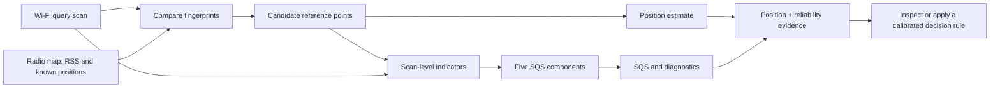

<div class="wf-hero" markdown="1">
<div class="wf-kicker">RESEARCH SOFTWARE · METHODS · REPRODUCIBILITY</div>

# Scan-level reliability for Wi-Fi fingerprinting

A reproducible framework for characterizing **scan-level reliability** and diagnosing conditions associated with large positioning errors. It evaluates measured RSS observations, radio-map matches and the spatial consistency of retrieved reference points alongside conventional Wi-Fi positioning estimates.

[Explore indicator definitions](learn/indicator-atlas.md){ .md-button .md-button--primary }
[Inspect measured scan diagnostics](learn/interactive-explorer.md){ .md-button }
[Compare two measured scans](learn/compare-scans.md){ .md-button }
[Explore SQS ablation results](learn/sqs-ablation.md){ .md-button }
[Explore research evidence matrix](results/evidence-matrix.md){ .md-button }
[Get started with real data](start/quickstart.md){ .md-button }
[Understand the idea](learn/overview.md){ .md-button }

<span class="wf-hero-footnote">Research implementation · Python and Android Java · Reproducible data and source</span>
</div>

<div class="wf-stats">
  <div><strong>18</strong><span>Selected diagnostic quantities</span></div>
  <div><strong>4</strong><span>Measured units you can run now</span></div>
  <div><strong>5,041</strong><span>Public example query scans</span></div>
  <div><strong>10</strong><span>Units in the original research evaluation</span></div>
</div>

## Explore the methodology and implementation

<div class="wf-card-grid">
  <a class="wf-card" href="learn/sqs-ablation/"><span class="wf-card-mark">NEW · FIVE-COMPONENT SQS</span><strong>Explore SQS anatomy and component ablations</strong><span>Reconstruct measured SQS values and compare the original A1 full-score, leave-one-out and single-component results.</span><em>Open SQS ablation lab →</em></a>
  <a class="wf-card" href="learn/compare-scans/"><span class="wf-card-mark">NEW · TWO-SCAN COMPARISON</span><strong>Compare the reliability evidence of two measured scans</strong><span>Linked SQS components, observed RSS, retrieved-template distances and diagnostic values from validated public examples.</span><em>Open scan comparison →</em></a>
  <a class="wf-card" href="results/evidence-matrix/"><span class="wf-card-mark">NEW · RESEARCH EVIDENCE</span><strong>Examine estimator and indicator performance</strong><span>Compare eight archived estimator summaries and 18 indicator association/discrimination results with uncertainty intervals and provenance.</span><em>Open evidence matrix →</em></a>
  <a class="wf-card" href="learn/indicator-atlas/"><span class="wf-card-mark">EQUATIONS · ANIMATED FIGURES</span><strong>Indicator definitions and computation</strong><span>Explore all 15 diagnostic measurements and three composites, including equations, units, measured examples, and animated signal/geometry explanations.</span><em>Open indicator atlas →</em></a>
  <a class="wf-card" href="learn/interactive-explorer/"><span class="wf-card-mark">INTERACTIVE · MEASURED DATA</span><strong>Inspect a measured scan and its SQS</strong><span>Switch between scans, inspect candidate coordinates and the five original components, and compare examples.</span><em>Open interactive explorer →</em></a>
  <a class="wf-card" href="learn/overview/"><span class="wf-card-mark">01 · LEARN</span><strong>Why evaluate scan-level reliability?</strong><span>Aggregate accuracy conceals scan-to-scan variation in reference support and spatial ambiguity.</span><em>Understand the problem →</em></a>
  <a class="wf-card" href="learn/walkthrough/"><span class="wf-card-mark">02 · FOLLOW</span><strong>How is each diagnostic computed?</strong><span>Trace RSS normalization, template matching, retrieved candidate geometry, composite scores and output verification.</span><em>Follow the pipeline →</em></a>
  <a class="wf-card" href="start/quickstart/"><span class="wf-card-mark">03 · RUN</span><strong>Run the native Python pipeline</strong><span>Run the released measured UJI and HK scans and inspect generated indicators.</span><em>Run the public example →</em></a>
  <a class="wf-card" href="results/how-to-read/"><span class="wf-card-mark">04 · INTERPRET</span><strong>Interpret outputs and indicators</strong><span>Find out what SQS, candidate spread, AP overlap and the results files actually mean.</span><em>Read the outputs →</em></a>
  <a class="wf-card" href="start/your-data/"><span class="wf-card-mark">05 · ADAPT</span><strong>Prepare your own radio map</strong><span>Use the canonical eight-column format and prepare a local radio map.</span><em>Prepare a dataset →</em></a>
  <a class="wf-card" href="results/evidence/"><span class="wf-card-mark">06 · VERIFY</span><strong>Verify the evidence and reproducibility scope</strong><span>Distinguish fresh runs, the historical HK predictions, ten-unit summaries, and synthetic examples.</span><em>Check evidence scope →</em></a>
</div>

## Processing architecture



!!! info "Interpretation of composite scores"
    The Scan Quality and Support Score (SQS) combines five cohort-normalized support components. It is **not a calibrated probability of correct localization**. Operational acceptance or warning thresholds require separately specified training, calibration, and held-out evaluation.

## What can you run today?

=== "Measured Wi-Fi data"

    ```bash
    python -m pip install -e ".[dev,empirical]"
    python scripts/reproduce_public_integrity.py
    python scripts/check_public_integrity_release.py
    ```

    Uses the released U01, U02, U03 and U09 units to generate 5,041 scan-level records and 50,410 candidate records.

=== "Positioning baseline"

    ```bash
    python scripts/reproduce_release.py --mode hk-u09
    ```

    Trains the existing KNN, WKNN and Random Forest implementations on HK U09, then evaluates 831 test scans. This is a new baseline, not a reconstruction of all eight historical estimators.

=== "Original stored results"

    ```bash
    python scripts/verify_existing_research_assets.py
    ```

    Validates the archived HK and approved ten-unit research results. This checks the **stored outputs**, not full historical model retraining.

## Explore further

- [Find and format published datasets](DATASET_DOWNLOADS_AND_FORMAT.md)
- [See the existing original indicators and SQS formulas](INDICATORS.md)
- [Open the Android import and build instructions](ANDROID.md)
- [Understand which claims are and are not validated](results/evidence.md)
- [View the GitHub source repository](https://github.com/AhmedMansoour/wifi-fingerprinting-scan-level-reliability)

<small>Manuscript under review. The article PDF, source hardware identifiers and original HK floor-plan assets are not distributed here. The code license does not replace the original datasets' licenses.</small>
