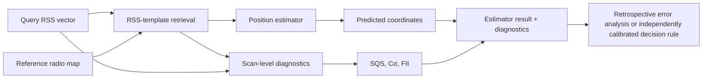

# Why scan-level integrity matters in Wi-Fi fingerprinting

Fingerprinting-based indoor positioning estimates a coordinate by comparing a query Wi-Fi RSS vector with previously surveyed reference fingerprints. Accuracy statistics, such as the median and 90th-percentile positioning errors, describe aggregate estimator performance but do not establish whether **one individual estimate has sufficient observable support**.

The proposed reliability layer examines the query and the supporting radio-map neighborhood to extract **15 individual diagnostic quantities**. These describe AP availability, signal-space compatibility, retrieved-candidate geometry, spatial reference-point support, and ambiguity. Three composite scores, SQS, Cσ, and FII, summarize complementary aspects of that evidence.

## Processing architecture

The diagnostic stream and the location estimator are related but **not equivalent**. A close RSS match can correspond to several spatially separated training positions, or to a different floor. Conversely, a spatially coherent neighborhood may have poor AP visibility. The individual measurements expose these cases rather than relying solely on an averaged error statistic.

## Five SQS support components

The **Scan Quality and Support Score (SQS)** combines normalized signal-match distance, candidate spatial coherence, AP count, AP-set overlap, and local reference-point density. Scaling uses the 5th and 95th percentiles of the **complete evaluation unit**, and the five component weights are equal. The value ranks relative support under the stated normalization; it is not a confidence probability or certified error bound.

For a particular deployed system, an acceptance threshold must be calibrated against appropriate labelled data and evaluated with the intended floor model, positioning estimator, and gross-error criterion.

## Inspect the actual formulas and examples

[Indicator atlas: 18 equations and animated diagrams](indicator-atlas.md){ .md-button .md-button--primary }
[Measured scan explorer](interactive-explorer.md){ .md-button }

**Evidence base:** the original study uses 10 evaluation units, eight estimators, 54,520 training scans, and 13,629 queries. The public executable examples currently contain four measured units. The [reproducibility notes](../REPRODUCIBILITY.md) separate original stored results from fresh native computations.
