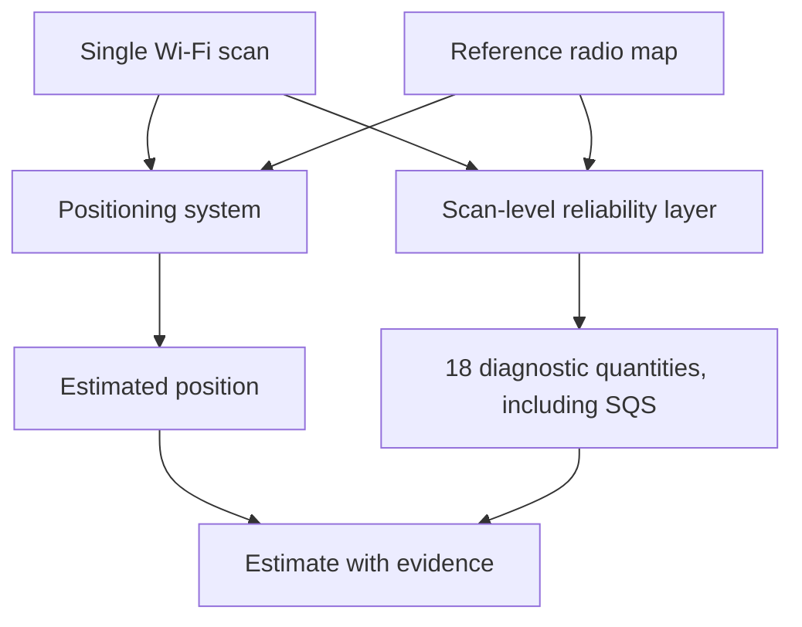

# Why inspect the reliability of a Wi-Fi position?

A smartphone can estimate an indoor position without GPS by comparing the strengths of nearby Wi-Fi signals with a previously collected **radio map**. The radio map contains Wi-Fi observations and known reference positions. A typical estimator returns a location, often summarized by its average error over many test scans.

But a single estimate can be unexpectedly wrong even when the average performance is acceptable. **For a navigation or sensor-fusion system, the question is not only _Where am I?_ but also _What evidence supports this particular estimate?_**

## Two scans, one positioning system

| | Scan with stronger support | Scan worth inspecting |
|---|---|---|
| Observable access points | Several known APs | Few known APs |
| Fingerprint similarity | Closely matches stored fingerprints | Poor or ambiguous matches |
| Retrieved candidate positions | Cluster reasonably together | Scattered between different areas |
| Interpretation | More supporting evidence | Less consistent supporting evidence |

The examples are **illustrative**, not measured cases or a fixed warning rule. A signal match that looks convincing can still produce a large error.

## The extra layer this project provides

Wi-Fi scan and radio-map data are used to calculate **18 selected diagnostic quantities**, including three composite indicators. The individual quantities describe signal observations, match quality, geometric support and ambiguity. Five support components are combined into a **Scan Quality and Support Score (SQS)**.

The scores can help **inspect, rank, compare, or flag** scans. They do not automatically justify deployment decisions, and an SQS value is not an error probability.

## Five SQS support components

1. **Signal-match support:** how compatible the scan appears with its best reference fingerprints.
2. **Candidate-geometry support:** whether candidate reference positions form a coherent neighborhood.
3. **AP-count support:** how much access-point evidence was observed.
4. **AP-overlap support:** how well the observed access-point set overlaps the radio map.
5. **Local-density support:** how well the retrieved neighborhood is supported by nearby reference points.

The documented SQS combines these five components with equal nominal weights and cohort-relative scaling. See [the full indicator table](../INDICATORS.md) for their scientific definitions and directional conventions.

!!! warning "Do not mistake high support for ground-truth correctness"
    The SQS is not a calibrated accuracy percentage, confidence interval, or guaranteed bound on positioning error. Gross-error classification requires the specified reference distribution and evaluation protocol.

**Next:** [Follow the pipeline on one scan](walkthrough.md) · [Run the public measured example](../start/quickstart.md).
