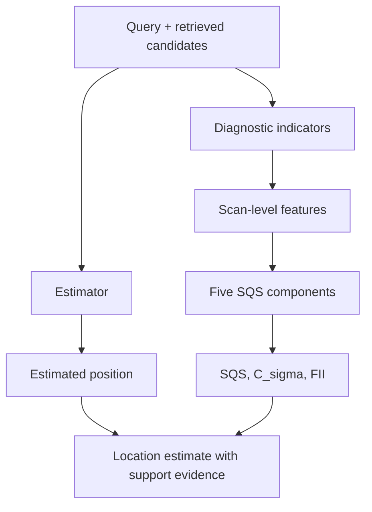

# Processing pipeline: scan to reliability diagnostics

The pipeline combines RSS-template retrieval, position estimation, and estimator-independent diagnostic computation. The example RSS values below illustrate the input schema; they are not an archived measurement.

## Step 1. Receive a query scan

A scan lists observed AP labels and signal strengths, for example:

```json
{"AP1": -61, "AP4": -76, "AP7": -83}
```

The labels are stable **within a data unit**. In the released HK data, `AP1` and `AP4` are pseudonymous labels, not real MAC addresses. Received signal strength (RSS) is measured in dBm; less negative numbers generally indicate stronger received signals.

## Step 2. Compare it with a radio map

A radio map is a table of **training Wi-Fi fingerprints paired with known local positions**. It is not a photograph or architectural floor plan. The pipeline compares the query's RSS values and observed APs with the training fingerprints.

| Radio-map role | Contents | Why needed |
|---|---|---|
| Reference fingerprint | Observed APs and RSS measurements | Compare signal patterns |
| Reference position | Local X and Y (and categorical floor when available) | Associate matches with a location |
| Evaluation query | Observed APs and held-out known position | Generate prediction and evaluate it retrospectively |

## Step 3. Retrieve candidate reference points

The implementation retrieves the most relevant candidate fingerprints. For the publicly computed integrity outputs, each query is associated with **ten diagnostic candidates**. The candidate file contains their ranks and relative metric coordinates.

## Step 4. Positioning and integrity run alongside each other



A positioning estimator, such as KNN or WKNN, uses reference fingerprints to infer a coordinate. The reliability layer evaluates the **strength and spatial consistency of the evidence**, not simply a second copy of the coordinate.

## Step 5. Summarize evidence using SQS

SQS combines five normalized components with equal nominal weights. Component scaling is relative to a reference cohort; it must not be interpreted as a calibrated probability of correctness.

## Step 6. Inspect the output

Each test scan generates an entry in `Uxx_scan_reliability.csv.gz`. The matching `Uxx_retrieved_candidates.csv.gz` gives the supporting reference candidates. A reader can ask:

- How many APs were observed?
- Were the fingerprint matches similar?
- Were the candidates spatially concentrated or dispersed?
- How did these properties contribute to SQS?
- Is any warning rule independently calibrated for the intended use?

For the four public empirical units, the code generates **5,041 scan-feature rows** and **50,410 candidate rows**.

!!! note "What this walkthrough does not claim"
    Running the indicator layer on public input does not retrain the eight original ESWA estimators, independently calibrate an online warning system, or regenerate every historical manuscript value.

**Inspect the definitions and equations:** [Interactive indicator atlas](indicator-atlas.md). **Examine actual measured scans:** [Scan-to-SQS explorer](interactive-explorer.md).

**Next:** [Run the actual code](../start/quickstart.md) · [Read the generated outputs](../results/how-to-read.md).
